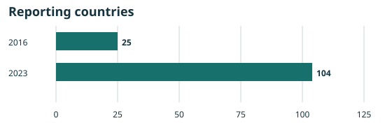

# Beyond the Bug

A Quarto book about antimicrobial resistance surveillance and the evidence behind it. The book is being developed to bring together the *Beyond the Bug* APE and ILE manuscripts, with reproducible Python figures.

The [first chapter](chapters/reporting.qmd) follows two published WHO counts from their source to a figure and asks what a change in participation can tell us.

## Read or build the example

1. Compare the [two observations](data/glass-participation.csv) with the [source note](data/README.md).
2. Install Python 3.9 or later and [Quarto](https://quarto.org/docs/get-started/).
3. From the repository root, run `quarto render`. The pre-render script redraws the figure from the CSV using Python’s standard library.
4. Open `_book/index.html`, or run `quarto preview` to read while editing.

To redraw the figure alone, run `python3 scripts/participation_figure.py`.
