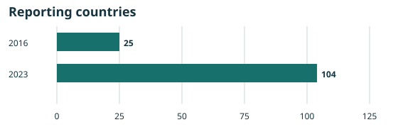

# Who contributed to the count?

In 2016, 25 countries reported to the World Health Organization’s Global Antimicrobial Resistance and Use Surveillance System (GLASS). By 2023, 104 countries contributed. Before comparing resistance figures across those years, consider who had the opportunity to appear in each figure.

{#fig-participation}

## Read the change

The later count includes 79 more reporting countries. That is a net difference. The totals alone cannot tell us which countries joined, which stopped reporting, or how many laboratories submitted results within each country. WHO also reports that 48% of countries supplied no data to GLASS in 2023.

Imagine two summaries of the same surveillance program. If the second draws on a different group of laboratories, its overall result can change even when each continuing laboratory reports the same proportion as before. To investigate a change in resistance over time, a reader would need comparable testing definitions, reporting sites and numbers tested in each period.

## Check the source

Open the [two-row CSV](../data/glass-participation.csv) and compare each value with the paragraph about country participation in WHO’s October 2025 release. The table contains the two endpoints WHO published in that paragraph. The years between them are left open.

Source: World Health Organization, 13 October 2025. [WHO warns of widespread resistance to common antibiotics worldwide](https://www.who.int/news/item/13-10-2025-who-warns-of-widespread-resistance-to-common-antibiotics-worldwide).
